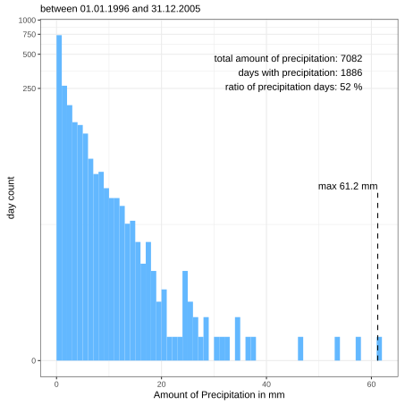
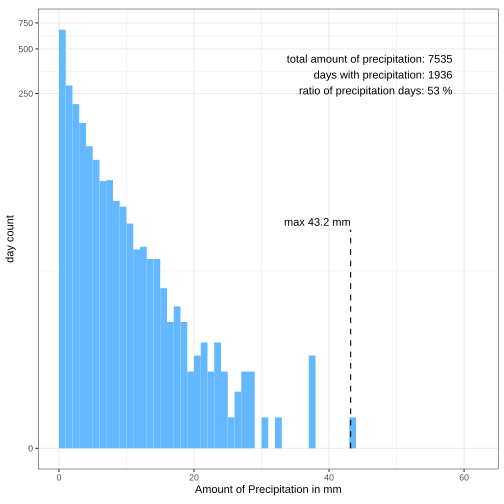
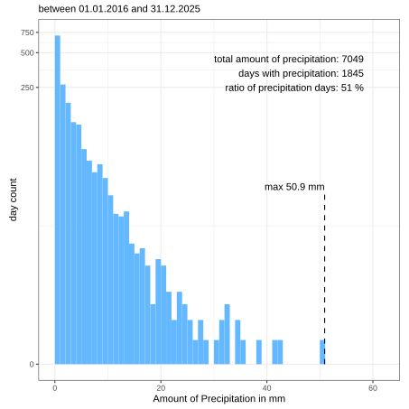
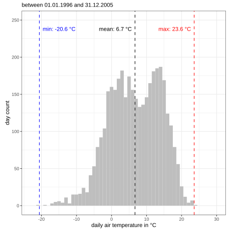
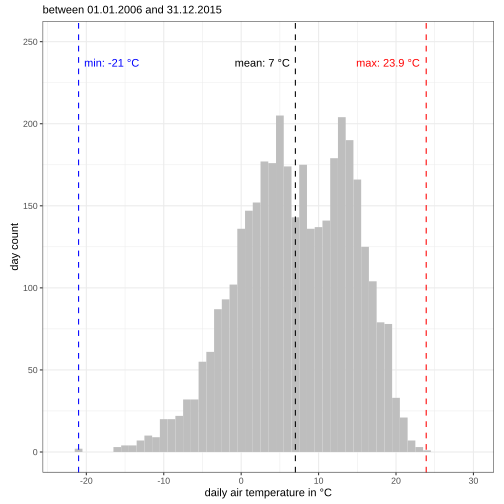
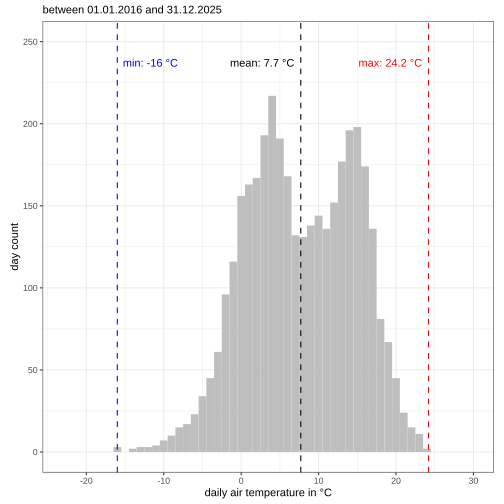

Bolmen is located in the warm-summer humid continental climate zone (Dfb) according to the Köppen-Geiger climate classification [@Jerue]. 

:::{style="width: 95%; margin:0 auto;"}

:::{#fig-bol-meteo-avg}
```{=html}
<iframe src="../../fig/html/meteo_avg_bol.html" width="100%" height="500px"></iframe> 
```

:::

:::

:::{style="width: 95%; margin:0 auto;"}

:::{#fig-bol-meteo-current}
```{=html}
<iframe src="../../fig/html/meteo_current_bol.html" width="100%" height="500px"></iframe> 
```


:::

:::

## Statistics

Changes in climate, with focus on precipitation and temperature have been observed in the catchment of Bolmen. According to @Klante_2023 an increase in extreme weather events can be observed, which may alter the local hydrology.
The following plots visualize the distribution of daily precipitation grouped in ten year intervals. 

:::{layout="[[33,33,33]]"}

:::{#fig-bol-met-hist_p-t0}

:::

:::{#fig-bol-met-hist_p-t10}

:::

:::{#fig-bol-met-hist_p-t20}

:::

:::

Variations in daily air temperatures are visualized in the following plots, which are grouped in ten year intervals. 

:::{layout="[[33,33,33]]"}

:::{#fig-bol-met-hist_t-t0}

:::

:::{#fig-bol-met-hist_t-t10}

:::

:::{#fig-bol-met-hist_t-t20}

:::

:::

## References {.unlisted}

:::{#refs}
:::