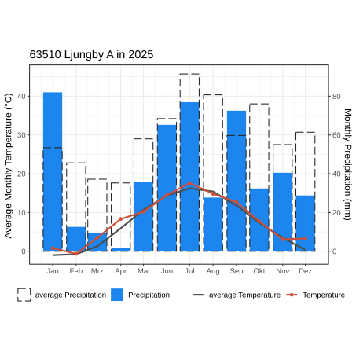

According to the Köppen-Geiger climate classification Bolmen is located in the warm-summer humid continental climate zone (Dfb)  [@Jerue]. 

:::{style="width: 95%; margin:0 auto;"}
:::{#fig-bol-meteo-avg-vs-current}


:::
:::

## Statistics

Changes in climate, with focus on precipitation and temperature have been observed in the catchment of Bolmen. According to @Klante_2023 an increase in extreme weather events can be observed, which may alter the local hydrology.
The following plots visualize the distribution of daily precipitation grouped in ten year intervals. 

:::{layout="[[33,33,33]]"}

:::{#fig-bol-met-hist_p-t0}


:::

:::{#fig-bol-met-hist_p-t10}


:::

:::{#fig-bol-met-hist_p-t20}


:::

:::

Variations in daily air temperatures are visualized in the following plots, which are grouped in ten year intervals. 

:::{layout="[[33,33,33]]"}

:::{#fig-bol-met-hist_t-t0}


:::

:::{#fig-bol-met-hist_t-t10}


:::

:::{#fig-bol-met-hist_t-t20}


:::

:::

## References {.unlisted}

:::{#refs}
:::