### Epilimnion

The current sampling for the epilimnion consist of analysis of the absorbance at differnt wavelength. 

:::{#fig-bol-epi-abs}

Absorbance measurements of the epilimnion. 

:::

### Profile 

#### Watertemperature 

:::{layout="[[45,45], [45,45], [-22.5, 45, -22.5]]"}

:::{#fig-bol-profileNW_TW}
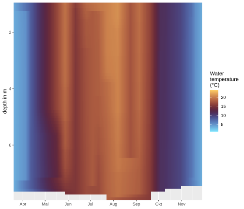

fig/svg/bol/WQ_profile_BOL_BS-NE_TW.svg
:::

:::{#fig-bol-profileNE_TW}

:::

:::{#fig-bol-profileW_TW}
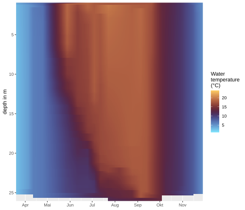
:::

:::{#fig-bol-profileE_TW}
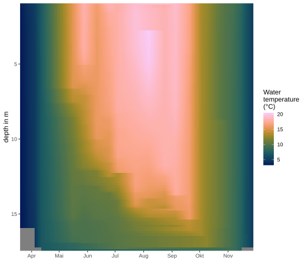
:::

:::{#fig-bol-profileS_TW}
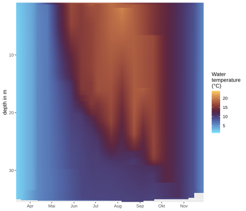
:::

:::

#### pH 

:::{layout="[[45,45], [45,45], [-22.5, 45, -22.5]]"}

:::{#fig-bol-profileNW_pH}
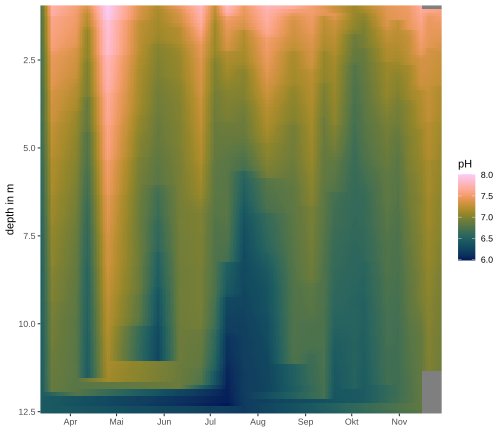
:::

:::{#fig-bol-profileNE_pH}
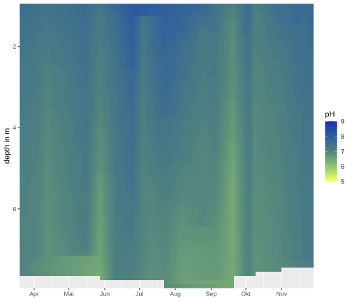
:::

:::{#fig-bol-profileW_pH}
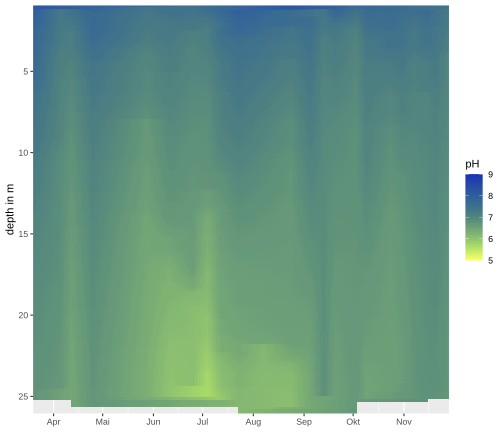
:::

:::{#fig-bol-profileE_pH}
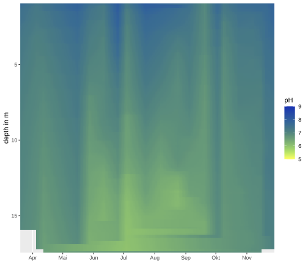
:::

:::{#fig-bol-profileS_pH}
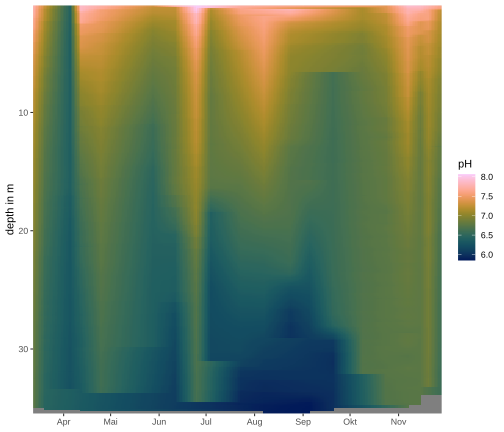
:::

:::

#### Oxygen

:::{layout="[[45,45], [45,45], [-22.5, 45, -22.5]]"}

:::{#fig-bol-profileNW_O2}
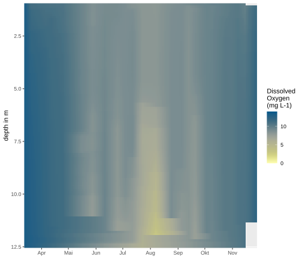
:::

:::{#fig-bol-profileNE_O2}
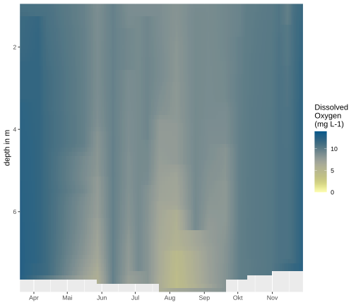
:::

:::{#fig-bol-profileW_O2}
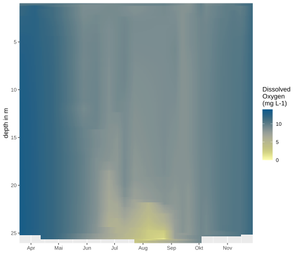
:::

:::{#fig-bol-profileE_O2}
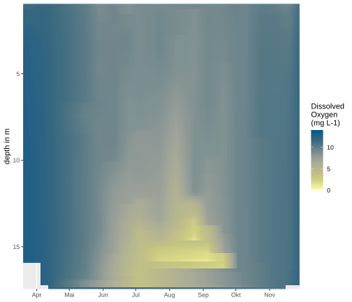
:::

:::{#fig-bol-profileS_O2}
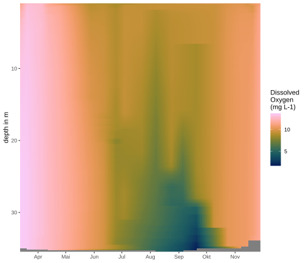
:::

:::

### PFAS