### Epilimnion

The current sampling for the epilimnion consist of analysis of the absorbance at differnt wavelength. 

:::{#fig-bol-epi-abs}
```{=html}
<iframe src="../../fig/html/CHE_Epilimnio_ABS420_bol.html" width="100%" height="500px"></iframe> 
```


:::

### Profile 

#### Watertemperature 

:::{layout="[[45,45], [45,45], [-22.5, 45, -22.5]]"}

:::{#fig-bol-profileNW_TW}
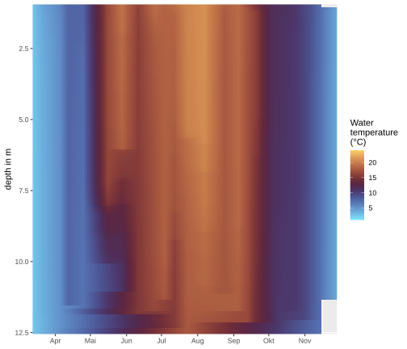



:::

:::{#fig-bol-profileNE_TW}
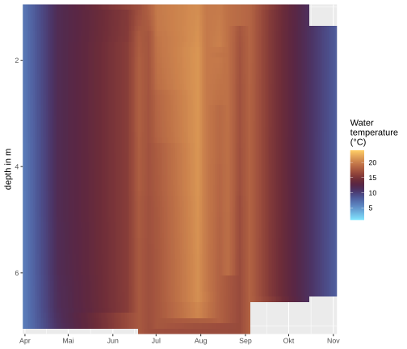



:::

:::{#fig-bol-profileW_TW}
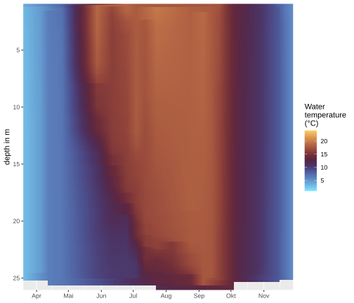


:::

:::{#fig-bol-profileE_TW}
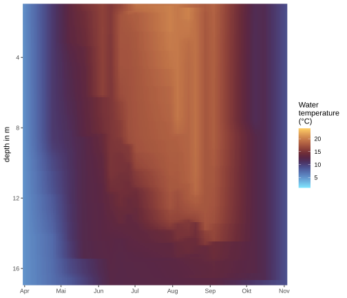



:::

:::{#fig-bol-profileS_TW}
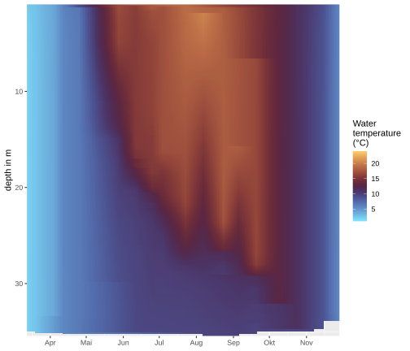



:::

:::


#### pH 

:::{layout="[[45,45], [45,45], [-22.5, 45, -22.5]]"}

:::{#fig-bol-profileNW_pH}
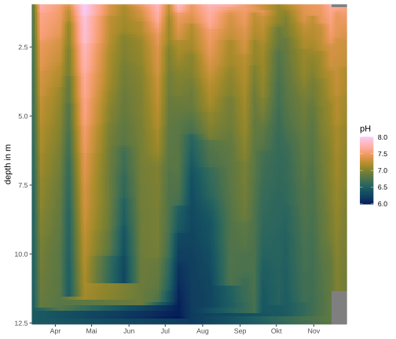

:::

:::{#fig-bol-profileNE_pH}
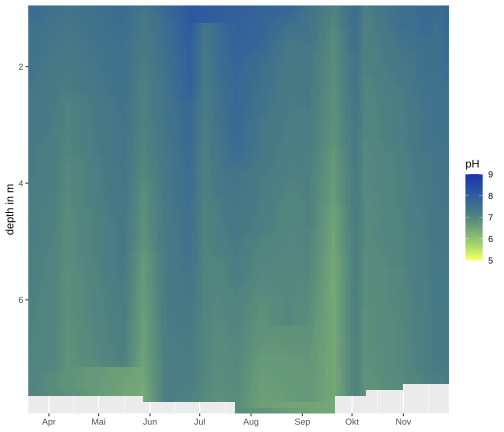

:::

:::{#fig-bol-profileW_pH}
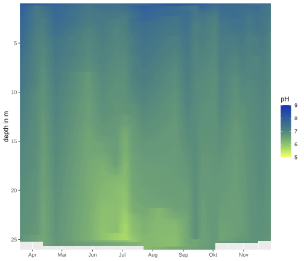

:::

:::{#fig-bol-profileE_pH}
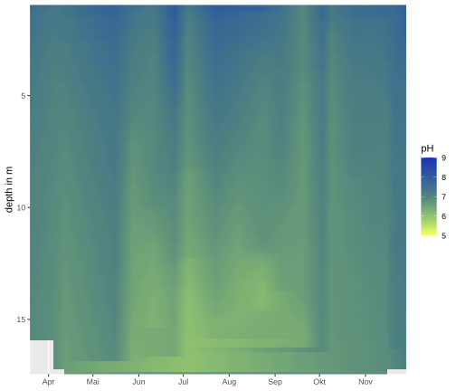

:::

:::{#fig-bol-profileS_pH}
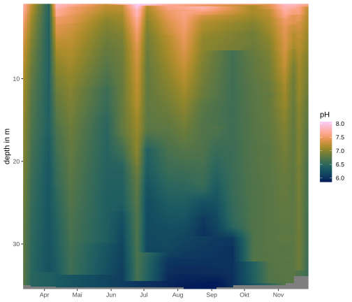

:::

:::

#### Oxygen

:::{layout="[[45,45], [45,45], [-22.5, 45, -22.5]]"}

:::{#fig-bol-profileNW_O2}
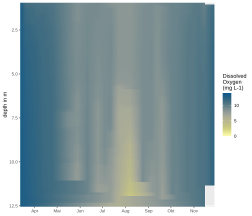

:::

:::{#fig-bol-profileNE_O2}
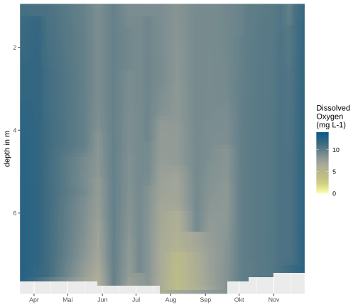

:::

:::{#fig-bol-profileW_O2}
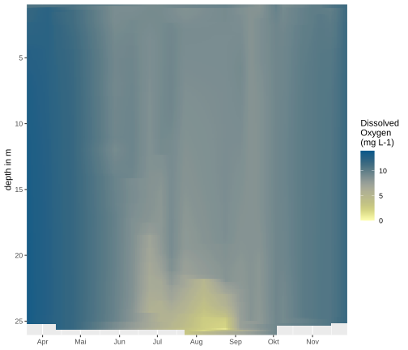

:::

:::{#fig-bol-profileE_O2}
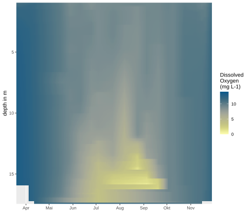

:::

:::{#fig-bol-profileS_O2}
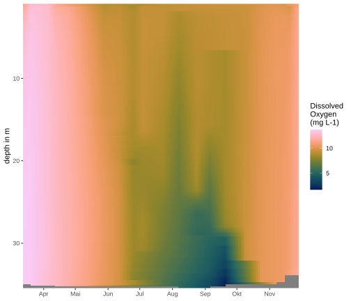

:::

:::


### PFAS