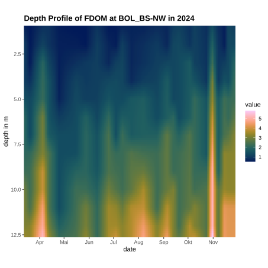
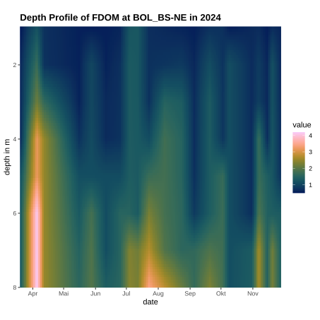
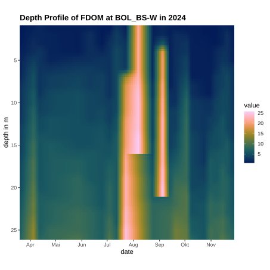
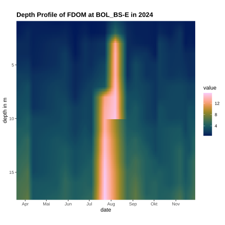
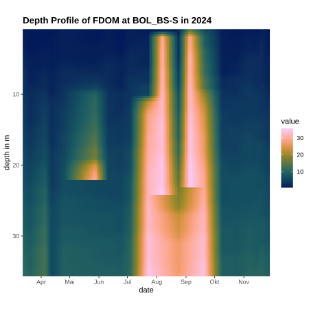

### Epilimnion

The current sampling for the epilimnion consist of analysis of the absorbance at differnt wavelength. 

:::{#fig-bol-epi-abs}

Absorbance measurements of the epilimnion. 

:::

### Profile 

#### fDOM 

:::{layout="[[45,45], [45,45], [-22.5, 45, -22.5]]"}

:::{#fig-bol-profileNW}

:::

:::{#fig-bol-profileNE}

:::

:::{#fig-bol-profileW}

:::

:::{#fig-bol-profileE}

:::

:::{#fig-bol-profileS}

:::

:::

### PFAS