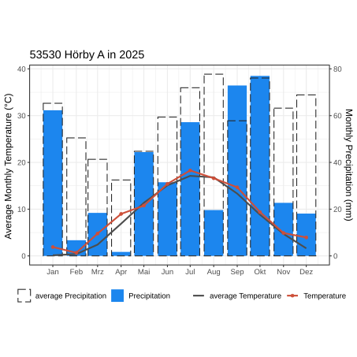
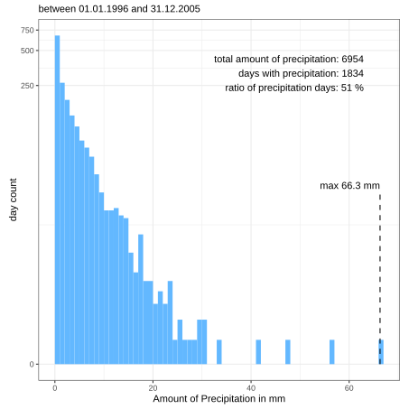
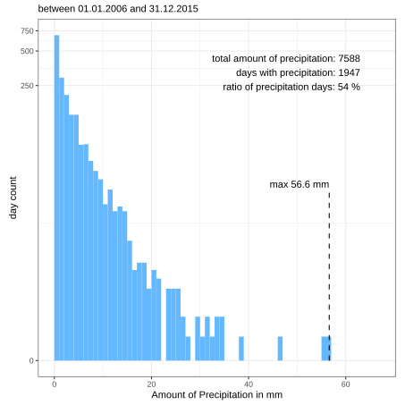
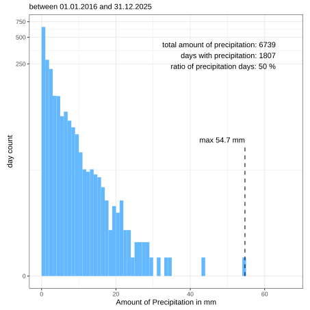
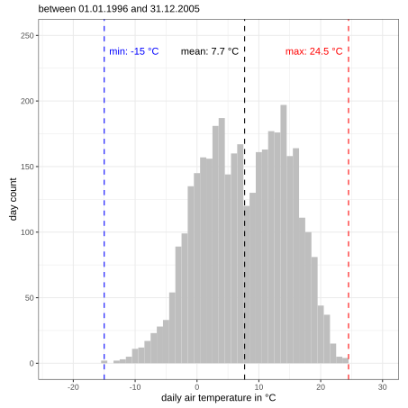
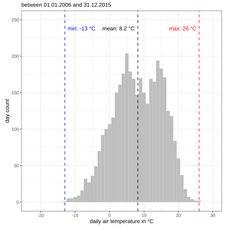
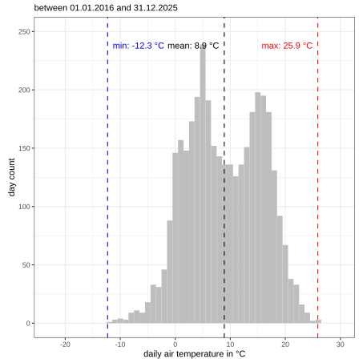

According to the Köppen-Geiger climate classification Ringsjön is located in the warm-summer humid continental climate zone (Dfb)  [@Jerue]. 

:::{style="width: 95%; margin:0 auto;"}
:::{#fig-rin-meteo-avg-vs-current}


:::
:::

## Statistics

Variations in daily precipitation sums are visualized in the following charts. Each chart represents a period of 10 years of observations.

:::{layout="[[33,33,33]]"}

:::{#fig-rin-met-hist_p-t0}


:::

:::{#fig-rin-met-hist_p-t10}


:::

:::{#fig-rin-met-hist_p-t20}


:::

:::

Variations in average air temperature are visualized in the following charts. Each chart represents a period of 10 years of observations.

:::{layout="[[33,33,33]]"}

:::{#fig-rin-met-hist_t-t0}


:::

:::{#fig-rin-met-hist_t-t10}


:::

:::{#fig-bol-met-hist_t-t20}


:::

:::

## References {.unlisted}

:::{#refs}
:::